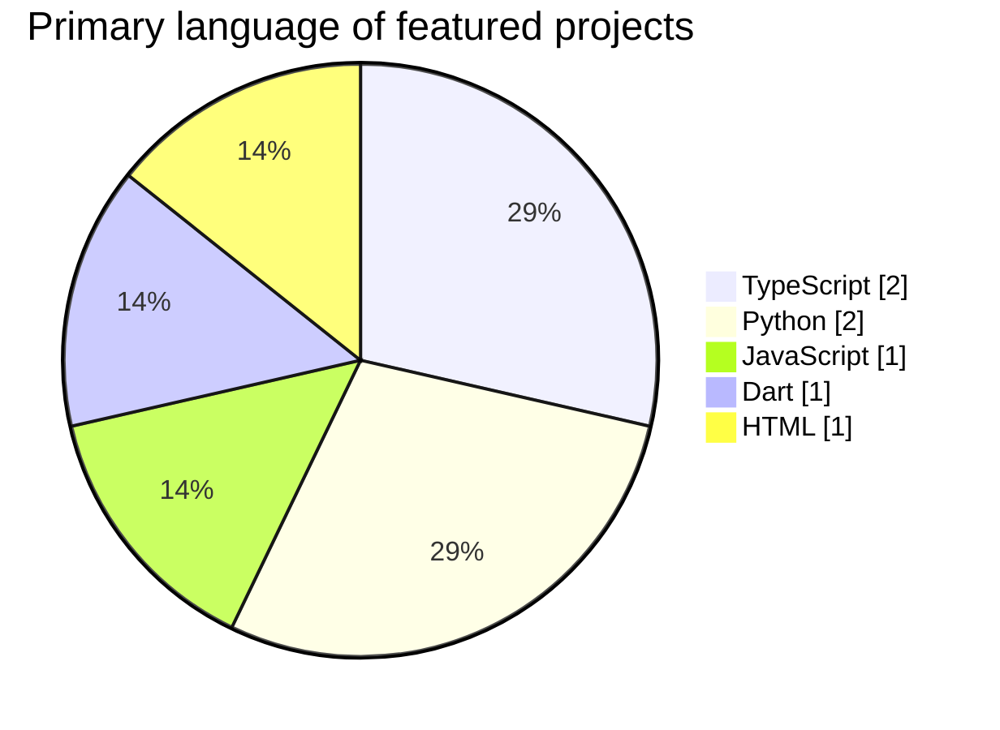
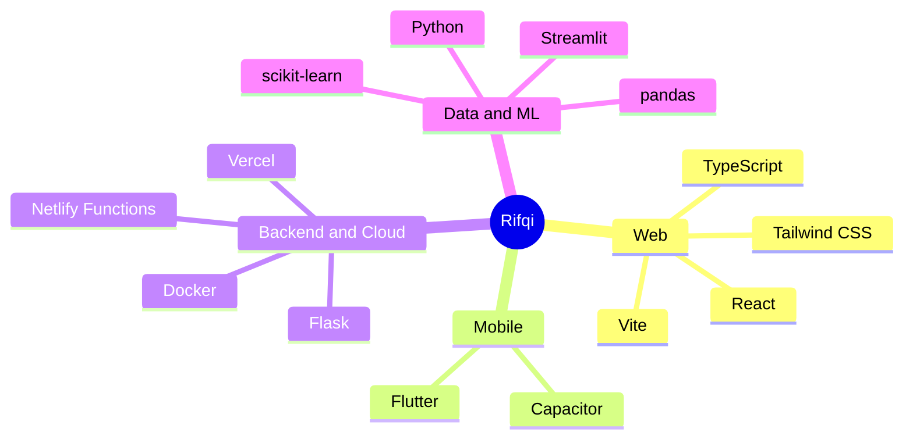
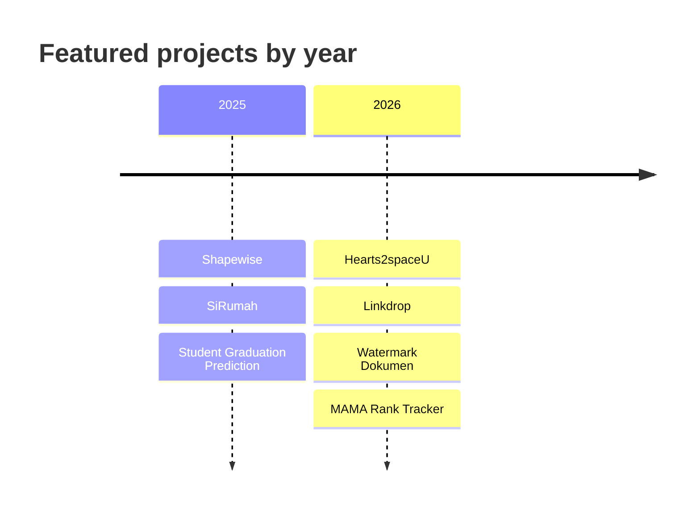

<h1 align="center">Rifqi's</h1>

  <b>Web & Mobile Developer</b> · Computer Science Student · Indonesia

  I build focused, privacy-respecting apps that people actually use, 
  from on-device document tools to data-driven dashboards and Flutter apps.

  
  
  

 

## About

- Building **web, mobile, and data** projects with React, Flutter, and Python.
- Care about **privacy by default**: files stay on the user's device whenever possible.
- Care about **accessibility**: AA contrast and scalable text are part of the definition of done.
- Currently exploring **PWAs, serverless functions, and machine learning** for real-world use cases.

 

## Tech Stack

  

  

  

Also: Capacitor, Streamlit, pandas, Playwright, pdf.js, Netlify Functions

  

## At a Glance

Click a section to expand it.

<b>Languages across featured projects</b>

 

Counted per project (one primary language each), not by lines of code or commits.

<b>Tech stack map</b>

 

<b>Project timeline</b>

 

 

## Featured Projects

### Privacy & Utility Tools

| Project | What it does | Stack | Links |
|:--|:--|:--|:--|
| **Watermark Dokumen** | Adds watermarks to ID cards, certificates, and payslips before they are shared. Everything runs on-device, with NIK masking, multi-page PDF, and metadata removal. | React · TypeScript · Capacitor | [Live](https://watermark-dokumen.vercel.app) |
| **Linkdrop** | Analyse and download public media from YouTube, Instagram, TikTok, X and more in its original format. Bilingual UI, subtitles, and multi-link ZIP export. | Python · Flask · yt-dlp · Docker | [Live](https://linkdrop-kappa.vercel.app) · [Repo](https://github.com/Zvareldric/Linkdrop) |

### Web & Mobile Apps

| Project | What it does | Stack | Links |
|:--|:--|:--|:--|
| **Hearts2spaceU** | All-in-one Flutter app for Hearts2Hearts fans: member profiles, schedule, releases, and awards. Clean Architecture with a custom, accessible design system. | Flutter · Dart | [Repo](https://github.com/Zvareldric/Hearts2spaceU) |
| **MAMA Rank Tracker** | Archives MAMA 2026 Fans' Choice rankings every hour and visualises podium, rank movement, and leaderboard. Installable PWA with offline support. | TypeScript · Vite · Netlify Functions | [Live](https://bagelen.netlify.app) |
| **Shapewise** | Interactive geometry learning platform with 3D shapes, adaptive quizzes, and a virtual lab. | React · JavaScript | [Repo](https://github.com/Zvareldric/lms-project) |
| **SiRumah** | Responsive landing page for a sharia-based financial reporting app for orphanages. | HTML · Tailwind CSS | [Live](https://sirumah-landing-page.vercel.app) · [Repo](https://github.com/Zvareldric/Sirumah-Landing-Page) |

### Data & Machine Learning

| Project | What it does | Stack | Links |
|:--|:--|:--|:--|
| **Student Graduation Prediction** | Predicts student graduation and dropout with a KNN model, served through an interactive Streamlit dashboard. | Python · scikit-learn · Streamlit | [Repo](https://github.com/Zvareldric/projek-datamining) |

More work: <a href="https://github.com/Zvareldric?tab=repositories">all repositories</a>

 

  Open to internships, freelance work, and collaboration on web, mobile, and data projects.

